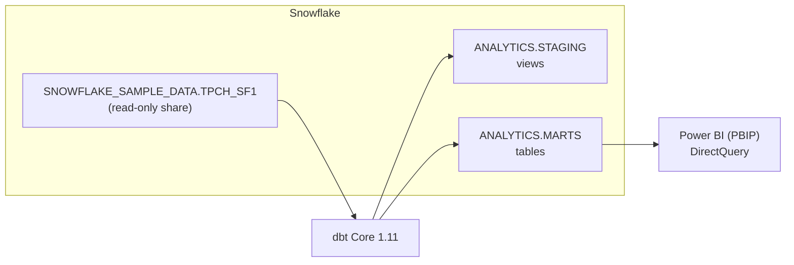

# Architecture

How the pieces of this repository fit together. The README covers the business questions and how to run the project; this file covers the structure.

## Data flow



dbt reads the TPC-H share, materializes staging as views and marts as tables in the `ANALYTICS` database, and Power BI queries the marts in DirectQuery.

## Layers

| Layer | Folder | Materialization | Rule |
|---|---|---|---|
| Sources | `models/staging/sources.yml` | none | Declared once, referenced with `source()` for lineage |
| Staging | `models/staging/` | view | Rename, type, deduplicate. No business logic |
| Intermediate | `models/intermediate/` | ephemeral | Reusable rollups that are never queried directly |
| Marts | `models/marts/` | table (`fct_sales` incremental) | Star schema and aggregates consumed by BI |

Shared business logic lives in `macros/` (`calculate_net_revenue`). Calendar logic, including the steady-state month window (`is_complete_month`), is defined once in `dim_date` and reused downstream.

## Environments and schemas

`macros/generate_schema_name.sql` decides where each model lands:

| Target | Staging schema | Marts schema | Used by |
|---|---|---|---|
| `prod` | `STAGING` | `MARTS` | Power BI |
| `dev` | `<schema>_STAGING` | `<schema>_MARTS` | Local development |
| `ci` | `dbt_ci_pr_<n>_STAGING` | `dbt_ci_pr_<n>_MARTS` | GitHub Actions, dropped after each run |

No target other than `prod` can write to the schemas the dashboard reads.

## Security model

- Authentication is key-pair only. No password is stored in the repository, in CI or in the local profile.
- CI runs as `DBT_CI_USER` with `DBT_CI_ROLE`: usage on the warehouse, read on the sample share, create schema on `ANALYTICS`. See `setup/snowflake_ci_role.sql`.
- The Power BI model reads its server from the `SnowflakeServer` parameter, committed as a placeholder.
- A CI guard fails the build if a real Snowflake account host is committed anywhere.

## CI

| Workflow | Trigger | Needs Snowflake | Steps |
|---|---|---|---|
| `.github/workflows/ci.yml` | every PR and push to `main` | no | account-host guard, `dbt parse --warn-error` |
| `.github/workflows/dbt_build.yml` | manual | yes | full `dbt build`, incremental pass on `fct_sales+`, drop CI schemas, upload run results |

The Snowflake build is manual because the sandbox account is a time-limited trial. The static workflow keeps the main branch verifiable after the trial ends.

## Repository map

```
models/            staging, intermediate, marts and their YAML (docs + tests)
macros/            schema routing, CI cleanup, shared business formula
tests/             singular data tests
ci/profiles.yml    CI-only dbt profile, every value from environment variables
setup/             one-time Snowflake setup for the CI identity
Dashboard.*        Power BI project (PBIP): semantic model and report as text
docs/              design notes and screenshots
```
