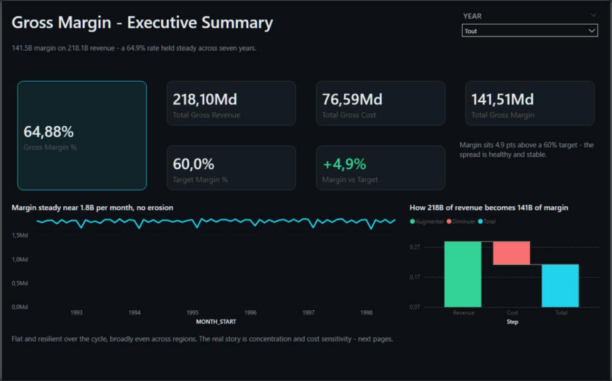
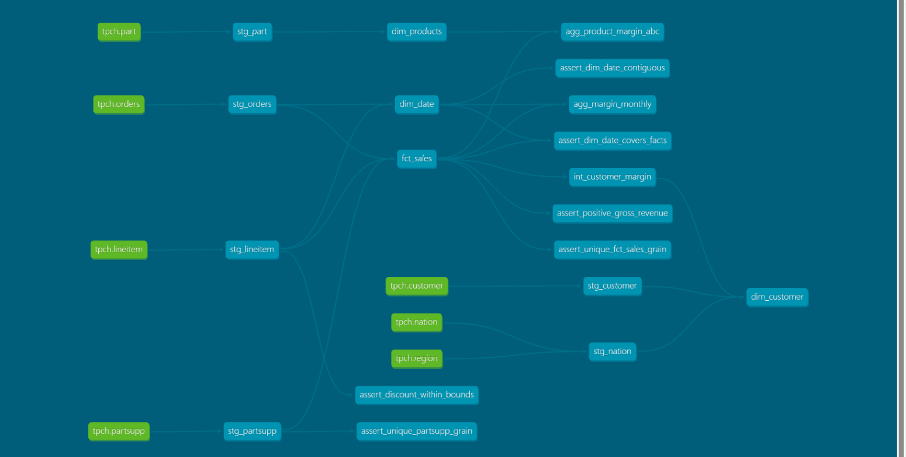
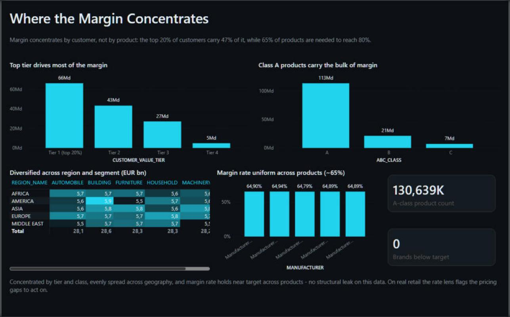
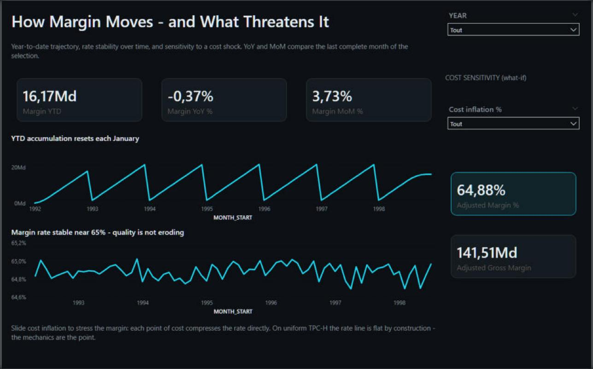
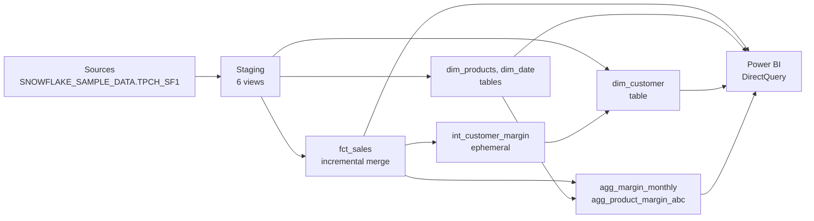

# Gross margin analytics on Snowflake + dbt

[](https://github.com/MasTristan/snowflake-dbt-gross-margin/actions/workflows/ci.yml)




## In short

Which products, customers and months carry the gross margin? This repo delivers a tested dbt pipeline on Snowflake (TPC-H sample data), a star schema, and a Power BI dashboard on top of it. Overall gross margin is 64.9% on 218.1 bn of revenue across 6,001,215 order lines.

> **FR :** Quels produits, clients et mois portent la marge brute ? Ce projet livre un pipeline dbt testé sur Snowflake (données TPC-H), un modèle en étoile et un dashboard Power BI. La marge brute globale est de 64,9 % sur 218,1 Md de chiffre d'affaires.

## What this demonstrates

- **ELT on Snowflake**: raw data transformed in the warehouse with dbt, from source tables to BI-ready models.
- **Layered modeling (Bronze, Silver, Gold)**: raw sources, cleaned staging, then a star schema and aggregates for reporting.
- **Data quality and CI/CD**: 52 automated data tests, a CI pipeline on every change and a full Snowflake build with an isolated, least-privilege identity.
- **Business delivery**: a Power BI dashboard answering margin questions by product, customer and month.

## Business questions answered

Measured on 2026-11-17 on `SNOWFLAKE_SAMPLE_DATA.TPCH_SF1`, prod target.

| Question | Model | Measured answer |
|---|---|---|
| Gross margin overall | `fct_sales` | 64.9% on 218.1 bn of revenue, 6,001,215 order lines |
| Is margin concentrated in a few products (Pareto)? | `agg_product_margin_abc` | 65.3% of products are needed to reach 80% of total margin, so margin is not concentrated (synthetic TPC-H data is near-uniform). 12 products are loss-making overall |
| How much do the best customers carry? | `dim_customer` | The top 20% of customers by margin (quintile 1) carry 46.8% of total gross margin |
| How does margin evolve over time? | `agg_margin_monthly` | Monthly margin with MoM, YoY and a 3-month moving average on a calendar month spine. 75 of 84 months are in the steady-state window (May 1992 to July 1998). The others are ramp-up and run-off caused by the TPC-H order window and a ship lag of up to 121 days, flagged by `is_complete_month` and hidden from the trend charts |

## Screenshots







## Architecture

| Medallion layer | In this project | Content |
|---|---|---|
| Bronze | dbt sources | Raw TPC-H tables (`SNOWFLAKE_SAMPLE_DATA.TPCH_SF1`), read as-is |
| Silver | `staging` (views) and `intermediate` (ephemeral) | Renamed, typed, deduplicated data, plus reusable rollups |
| Gold | `marts` (tables) | Star schema (`fct_sales` + dimensions) and aggregates read by Power BI |




The intermediate model `int_customer_margin` rolls up `fct_sales` per customer and feeds the margin quintile of `dim_customer`. Environments, schema routing, security model and CI are described in [ARCHITECTURE.md](ARCHITECTURE.md).

<details>
<summary>Models, with grain and materialization</summary>

| Layer | Model | Grain | Materialization |
|---|---|---|---|
| Staging | `stg_lineitem` | order line (`order_key`, `line_number`), deduplicated | view |
| Staging | `stg_orders` | order | view |
| Staging | `stg_customer` | customer | view |
| Staging | `stg_part` | part | view |
| Staging | `stg_partsupp` | part and supplier (`part_key`, `supplier_key`) | view |
| Staging | `stg_nation` | nation, joined to its region | view |
| Intermediate | `int_customer_margin` | customer | ephemeral |
| Marts | `fct_sales` | order line (`order_key`, `line_number`) | incremental (merge) |
| Marts | `dim_customer` | customer, with margin quintile and value tier | table |
| Marts | `dim_products` | part | table |
| Marts | `dim_date` | calendar day | table |
| Marts | `agg_product_margin_abc` | product, with cumulative share and ABC class | table |
| Marts | `agg_margin_monthly` | calendar month | table |

In the `prod` target, staging lands in `ANALYTICS.STAGING` and marts in `ANALYTICS.MARTS`. Any other target prefixes these schemas with its own `schema` setting.

</details>

## Engineering choices

<details>
<summary>Ten design decisions and why</summary>

| Decision | Why |
|---|---|
| Star schema rather than Data Vault | One business metric and a BI consumer: a dimensional model is the right level of complexity. Data Vault would add hubs, links and satellites with no query benefit here. |
| `fct_sales` is incremental (merge) with a lookback window | It is the largest table. The merge on (`order_key`, `line_number`) reloads the last `lookback_days` (3) days before the current max `ship_date`, so late lines are absorbed without duplicates. |
| Composite-key join on `partsupp` | A part has several suppliers at different costs. Joining on `part_key` alone would fan out the fact table and attach the wrong cost, corrupting the margin. The join uses (`part_key`, `supplier_key`), and two singular tests guard the grain. |
| Deduplication in staging with `qualify` | `stg_lineitem` keeps one row per (`order_key`, `line_number`), so downstream models can trust the grain. |
| `calculate_net_revenue` macro | The business definition `price * (1 - discount)` lives in one place, with `coalesce` on the discount. |
| Schema isolation per target (`generate_schema_name`) | Only `prod` writes to `STAGING` and `MARTS`, which the dashboard reads. Every other target (`dev`, `ci`) prefixes the schema, so a CI or dev run can never overwrite prod. |
| Calendar month spine and `is_complete_month` | `agg_margin_monthly` left joins a gapless month spine, so `lag(1)` and `lag(12)` are true calendar shifts. `is_complete_month` is defined once in `dim_date` from the data itself (first order date plus the maximum ship lag, last order date), so BI hides ramp-up and run-off months instead of showing a fake collapse. |
| `nullif` rather than `div0` | A zero denominator gives NULL, not a misleading 0%. Margin percentages and MoM / YoY changes stay honest when the base is zero. |
| `dim_date` built from a real date spine | One row per day between the first order and the last shipment, so time intelligence has no gaps. Contiguity and coverage of the fact dates are tested. |
| Key-pair auth and a least-privilege role for CI | No password stored anywhere. `DBT_CI_ROLE` can create schemas in `ANALYTICS` and read the sample data, nothing else. |

Longer write-up: [docs/design-notes.md](docs/design-notes.md).

</details>

## Testing and CI

52 data tests, a static CI on every push and a manual full build on Snowflake, all green. Full build of 64 nodes in about 19 s on an XSMALL warehouse.

<details>
<summary>Tests, workflows and security details</summary>

There are 52 data tests: 46 generic tests declared in the `schema.yml` files (30 `not_null`, 9 `unique`, 4 `relationships`, 3 `accepted_values`) and 6 singular tests in `tests/`. Count method: one line per generic test entry in `models/*/schema.yml`, plus the number of `.sql` files in `tests/`.

Singular tests cover:

- `assert_unique_fct_sales_grain`: one row per order line after the `partsupp` join.
- `assert_unique_partsupp_grain`: (`part_key`, `supplier_key`) is unique upstream of the join.
- `assert_positive_gross_revenue`: no order line with revenue of zero or less.
- `assert_discount_within_bounds`: discount is not NULL and lies in [0, 1].
- `assert_dim_date_contiguous`: no missing or duplicated day in `dim_date`.
- `assert_dim_date_covers_facts`: `dim_date` spans every `ship_date` in `fct_sales`.

Two GitHub Actions workflows:

- `ci.yml` runs on every pull request and push to `main`. It needs no Snowflake account: a guard fails the build if a Snowflake account identifier is committed, then `dbt parse --warn-error` checks refs, YAML and test configuration.
- `dbt_build.yml` is triggered manually. It runs a full `dbt build` in an isolated `dbt_ci_pr_*` schema, then a second pass on `fct_sales+` to exercise the incremental path, then drops the CI schemas. It is manual because the Snowflake account is a time-limited trial, so it is not wired to pull requests.

Measured on an XSMALL warehouse: full build of 64 nodes in about 19 s, incremental pass on `fct_sales+` in about 15 s, 0 failures.

CI connects with key-pair authentication as `DBT_CI_USER`, using `DBT_CI_ROLE`, a least-privilege role defined in [setup/snowflake_ci_role.sql](setup/snowflake_ci_role.sql).

</details>

## Run it yourself

<details>
<summary>Setup, profile and commands</summary>

Prerequisites: Python 3.11 and a Snowflake account (a free trial is enough).

```bash
pip install -r requirements.txt
```

1. In Snowflake, run `setup/snowflake_ci_role.sql` section by section as described in its header. It creates the `DBT_WH` warehouse, the `ANALYTICS` database, a `DBT_CI_ROLE` role and a `DBT_CI_USER` service user with your public key, and grants read access to `SNOWFLAKE_SAMPLE_DATA`.
2. Create `~/.dbt/profiles.yml`:

```yaml
ae_tpf_project:
  target: dev
  outputs:
    dev:
      type: snowflake
      account: <account_identifier>
      user: <your_user>              # your own user, not the CI service user
      private_key_path: <path_to_your_key.p8>
      role: SYSADMIN
      database: ANALYTICS
      warehouse: DBT_WH
      schema: dbt_dev
      threads: 4
    prod:
      type: snowflake
      account: <account_identifier>
      user: <your_user>
      private_key_path: <path_to_your_key.p8>
      role: SYSADMIN
      database: ANALYTICS
      warehouse: DBT_WH
      schema: public
      threads: 4
```

3. Build and explore:

```bash
dbt build                  # dev target: schemas are prefixed (dbt_dev_staging, dbt_dev_marts)
dbt build --target prod    # ANALYTICS.STAGING and ANALYTICS.MARTS
dbt docs generate && dbt docs serve
```

There is no `packages.yml`, so `dbt deps` is not needed.

Power BI: open `Dashboard.pbip` in Power BI Desktop and set the `SnowflakeServer` parameter to your own Snowflake host.

</details>

## Known limitations

<details>
<summary>What a production version would change</summary>

These are deliberate choices for a single-sandbox project. For each, what a production version would do.

- **PII.** `dim_customer` exposes `sha2(customer_name, 256)`, an unsalted hash, and `customer_name` is still in clear text in the `stg_customer` view. Production: a masking policy on the column plus restricted grants on the staging schema.
- **Late changes to existing lines.** The incremental merge does not propagate a change of `supply_cost` or `order_status` on lines already loaded. Production: a scheduled `dbt run --full-refresh -s fct_sales`.
- **Loss-making products.** `agg_product_margin_abc` does not isolate products with a negative total margin, which sort last and can nudge the tail of the classification. Production: flag them as a separate class.
- **No slim CI, no deployment job.** There is a single sandbox account. Production: state-based slim CI on pull requests and a scheduled deployment job with separate dev and prod accounts or environments.
- **Power BI storage mode.** The fact, the three dimensions and the two aggregates (`FCT_SALES`, `DIM_CUSTOMER`, `DIM_PRODUCTS`, `DIM_DATE`, `AGG_PRODUCT_MARGIN_ABC`, `AGG_MARGIN_MONTHLY`) are in DirectQuery against Snowflake. Only the calculated tables and measures (`Bridge`, `Cost inflation %`, `_Measures`) are in import mode. Every visual therefore queries the warehouse; production would consider import or aggregations for the high-traffic pages.

</details>

## Contact

Tristan Mas, data engineer (dbt, Snowflake, SQL). Open to freelance missions and full-time roles.

[LinkedIn](https://www.linkedin.com/in/tristan-mas/)
